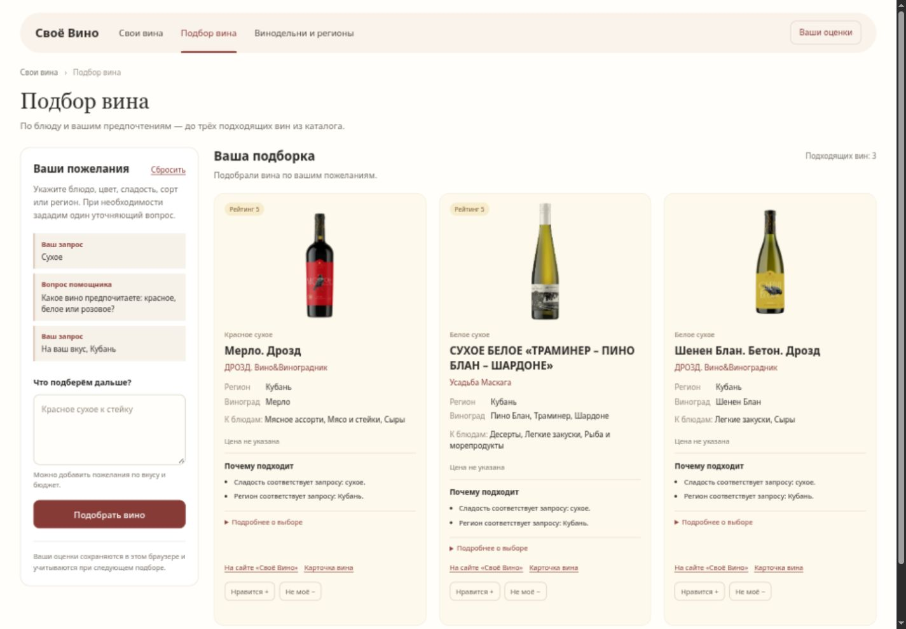
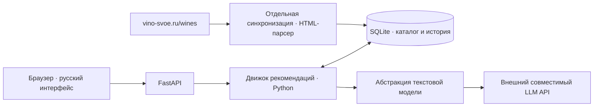

# «Своё Вино» — винный помощник

Выбрать вино к ужину непросто: нужно учесть блюдо, сладость, сорт и собственные
вкусы. Свободный ответ языковой модели при этом может предложить бутылку,
которой нет в магазине, или придумать её характеристики и цену.

Наш локальный MVP ведёт диалог на русском, уточняет пожелания и подбирает
**до трёх реальных вин из каталога [vino-svoe.ru](https://vino-svoe.ru/wines)**.
Python проверяет ограничения и ранжирует карточки, SQLite хранит каталог и
оценки, а внешний текстовый LLM помогает разбирать запросы и выбирать
подтверждённые объяснения. Без него работает ограниченный резервный разбор.



*Скриншот работающего приложения на включённом в репозиторий реальном снимке.
Режим без внешней модели, интерфейс и объяснения на русском.*

## Что умеет продукт

- Принимать пожелания по блюду, цвету, сладости, сорту, региону, производителю
  и поддерживаемым вкусовым признакам; задавать один полезный вопрос за шаг.
- Строго соблюдать явные ограничения и объяснять совпадения данными источника.
- Показывать реальные карточки, исходные ссылки, доступные характеристики
  и честное «Цена не указана» вместо предположений.
- Учитывать лайки и дизлайки в следующих подборках, сохраняя историю локально.
- Работать на обычном ноутбуке: без локальной модели, эмбеддингов, векторной
  базы, Docker и сборки фронтенда.
- Воспроизводимо проверять рекомендации без сети и расходования LLM-квоты.

[Скриншот после лайка →](docs/screenshots/personalization.jpg) ·
[Измеренные результаты →](docs/evaluation-results.json)

## Как устроен подбор

```text
Сообщение пользователя
→ извлечение намерения и проверка Pydantic
→ обязательные фильтры Python
→ прозрачные баллы совпадений
→ ограниченное влияние персонализации
→ до трёх реальных карточек из локального каталога
→ проверенное объяснение
```

Рейтинг каталога может влиять на порядок, но сам по себе не даёт допуска к
рекомендации. Лимит — максимум: если подходящих вин одно или два, система
не дополняет ответ посторонними. Если подтверждённых совпадений нет,
она сообщает об этом. В API можно запросить от одной до пяти позиций;
интерфейс запрашивает максимум три.



**Каталог — источник истины.** LLM не создаёт позиции и не рекомендует вина
из собственной памяти. ID появляются после поиска, фильтров и ранжирования
реальных записей Python. Сервер повторно проверяет каждый ID и читает
фактические поля из SQLite: название, производителя, регион, сорта, категорию,
цену и ссылки. Сгенерированные копии фактов игнорируются, неизвестные ID
отвергаются. У каждой сохранённой карточки остаётся `source_url`.

Внешней модели не передаётся весь каталог. При разборе она получает запрос
и список существующих категорий еды; при объяснении — короткий список уже
выбранных ID с подтверждёнными причинами. Произвольные дегустационные заметки
модели не выводятся: она может выбрать только существующие причины.

Каталог загружается детерминированным HTML-парсером, **без LLM**.
Синхронизация — отдельная операция; обычный запрос читает локальный снимок
и не загружает сайт заново. Неизвестные поля остаются пустыми.

### Персонализация

Лайк повышает балл понравившейся позиции и карточек с общими подтверждёнными
признаками; дизлайк снижает его. Учитываются реальные цвет, сладость, сорта,
регион, производитель, сочетания с едой и признаки из описаний. Последняя оценка
заменяет предыдущую, повторные лайки не накапливают вес; показы и открытия
не считаются предпочтением. Вклад истории ограничен диапазоном −6…+6.

История не отменяет обязательный цвет, сорт или строгий бюджетный фильтр
и сама по себе не делает нерелевантное вино подходящим. В интерфейсе влияние
истории объясняется словами, без технических баллов.

### Почему мы не обещаем соблюдение бюджета

**Надёжное систематическое поле цены в исходном каталоге пока не подтверждено.**
Модель данных поддерживает `price_rub`, а интерфейс `PriceProvider` позволяет
подключить доверенный источник позже. До этого неизвестные цены не выводятся
из рейтинга, описания или ответа LLM и не заменяются выдуманными числами.

При запросе бюджета система честно предупреждает, что не может гарантировать
его соблюдение. Если доверенные цены появятся, строгий фильтр пропустит только
известные цены не выше лимита; `None` никогда не считается нулём.
Это осознанная защита от недостоверных рекомендаций.

## Быстрый локальный запуск

Нужны **Python 3.14+** и [uv](https://docs.astral.sh/uv/).
После установки зависимостей всё приложение запускается одной командой:

```bash
git clone https://github.com/VenEraBle842/ai-sommelier.git
cd ai-sommelier
uv sync --locked
cp .env.example .env
uv run --env-file .env python -m app.demo --offline
```

Откройте **http://127.0.0.1:8000**. Остановка — **Ctrl+C**: сервер освобождает порт.
Если `.env` уже существует, сохраните его вместо повторного копирования.
Для другой демонстрационной базы или порта доступны `--db` и `--port`.

Команда `app.demo` явно наполняет **только пустую** `data/demo.sqlite3` тремя
реальными сохранёнными HTML-карточками, проверяя SHA-256; существующие карточки
и оценки не перезаписывает. Это тот же API и движок, без заранее зашитых ответов.
`--offline` отключает внешний LLM независимо от окружения. Для карточек,
текстового подбора и оценок сеть не нужна; фотографии загружаются браузером
с сайта и при недоступности заменяются нейтральным сообщением.

Снимок включён намеренно: [манифест источников](app/evaluation/data/snapshot.json),
[происхождение HTML](tests/fixtures/README.md). Это три реальные позиции,
а не полный актуальный ассортимент. В обычном запуске API снимок автоматически
не импортируется; `app.demo` — отдельная явная демонстрационная команда.

### Внешняя текстовая модель — по желанию

Заполните `.env` и запустите без `--offline`:

```bash
uv run --env-file .env python -m app.demo
```

| Переменная | Назначение |
| --- | --- |
| `LLM_API_KEY` | Секретный ключ совместимого внешнего сервиса |
| `LLM_MODEL` | Имя доступной текстовой модели |
| `LLM_BASE_URL` | HTTPS-адрес совместимого API с базовым путём; клиент добавляет `/chat/completions` |
| `LLM_TIMEOUT_SECONDS` | Необязательный тайм-аут: 20 секунд по умолчанию, максимум 120 |
| `WINE_DB_PATH` | Необязательный путь рабочей базы для обычного API и синхронизации; `app.demo` использует `--db` |

Для режима без внешней модели обязательных переменных нет. Ключ, модель и URL
нужны вместе только для LLM. Файл загружает uv через `--env-file`; приложение
читает окружение. `.env` игнорируется Git, `.env.example` не содержит секретов.
Клиент не привязан к коммерческому поставщику. Сетевой сбой или неверный JSON
не повреждают каталог: приложение переходит к ограниченному разбору.

### Обновление каталога с сайта

Вместо малого демонстрационного снимка можно создать рабочую базу:

```bash
uv run --env-file .env python -m app.catalog.sync --pages 2 --limit 30
uv run --env-file .env uvicorn app.api.main:app --host 127.0.0.1 --port 8000 --log-level warning
```

SQLite `data/catalog.sqlite3` и таблицы создаются автоматически; миграции вручную
не нужны. Повторная синхронизация обновляет карточки по исходному URL без
дубликатов. Сеть нужна только для обновления каталога и, при включении, LLM.
Число загруженных карточек может быть меньше `--limit`.

Загрузчик соблюдает robots.txt, делает паузы, использует тайм-ауты и ограниченные
повторы. При CAPTCHA, запрете доступа или ограничении частоты останавливается;
обход ограничений не выполняется. Если сайт недоступен, для знакомства с
продуктом используйте включённый реальный снимок.

## Что измерено

Автономный прогон: **24 сценария, 3 реальные карточки, 24 рекомендации, K=3**.
20 сценариев используют ограниченный текстовый разбор, 4 — заранее
структурированные условия. Это не оценка понимания текста внешней моделью.

| Метрика | Результат на этой выборке |
| --- | --- |
| Валидность ID каталога | 24/24 — 100% |
| Доля выдуманных ID | 0/24 — 0% |
| Соблюдение оцениваемых обязательных условий | 23/23 — 100% |
| Совпадение с реальными сочетаниями еды | 4/6 — 66,7% |
| HitRate@3: хотя бы одно попадание по эталону | 16/16 положительных сценариев — 100% |
| Ожидаемое поведение сценариев, включая отказы и уточнения | 24/24 |
| Фактические поля совпадают с SQLite | 24/24 |
| Проверка эффекта персонализации | 1/1: второе место → первое, балл 0 → 6 |
| Точность бюджета | N/A — нет наблюдений с подтверждёнными ценами |

Food Match ниже 100%: в запросах к рыбе и десерту первая позиция подходит по
еде, но дополнительные карточки могут совпадать только по цвету и сладости.
HitRate@3 этого недостатка не отражает, поскольку требует хотя бы одно попадание.
Результаты не скрыты и не заменены утверждением «точность системы 100%».

[Полный JSON с числителями, знаменателями и сценариями](docs/evaluation-results.json) ·
[Методика и границы оценки](docs/EVALUATION.md)

```bash
uv run pytest
uv run python -m app.evaluation
uv run ruff check .
uv run ruff format --check .
uv run mypy
node tests/test_ui_messages.mjs
```

Автотесты блокируют реальные сетевые соединения; оценка не создаёт сетевых
клиентов. Ответы LLM проверяются через `FakeLLM` и `httpx.MockTransport`. Регрессии проверяют неизвестные ID,
подмену фактов, обязательные ограничения, неизвестные цены, семантику вкуса,
безопасные ошибки, сохранность базы и полный цикл уточнения и оценки вина.

## Что важно учитывать

- Снимок очень маленький и ограничивает разнообразие. Нулевые галлюцинации
  на нём не означают доказательства качества для любого входного текста.
- Резервный парсер намеренно поддерживает небольшой русский словарь.
  Сложную фразу без внешней модели может попросить переформулировать.
- Вкусовые признаки подтверждаются текстом источника. Интенсивный аромат
  не равен полнотелости; отсутствие нежелательного признака в описании
  не доказывает его отсутствия у вина.
- Регистрации нет: браузер хранит UUID, а события — SQLite. Это локальная
  демонстрация; UUID не защищает историю как учётная запись. Не открывайте
  сервер во внешнюю сеть. Очистка хранилища браузера теряет связь с оценками.
- Парсер зависит от разметки сайта, удалённые позиции автоматически не
  удаляются. Синхронизация не гарантирует актуальность цен или наличие в продаже.
- Реальная доступность внешнего API проверяется отдельно. Автотесты не расходуют
  квоту и не измеряют качество конкретной облачной модели.

## Навигация по репозиторию

```text
app/
  api/             FastAPI: чат, оценки, история, каталог
  catalog/         детерминированная загрузка и репозиторий
  db/              SQLite и таблицы SQLAlchemy
  recommendation/  намерение, фильтры, баллы, подтверждённые признаки
  users/           история и профиль предпочтений
  llm/             абстракция, совместимый HTTP-клиент и подмена для тестов
  evaluation/      эталон, реальные HTML, независимые метрики
  web/             русский интерфейс, локальные CSS и JavaScript
  demo.py          явный запуск на реальном малом снимке
tests/             проверки без реальной сети
docs/              методика, отчёт, безопасность и скриншоты
```

[API, веса и технические подробности](docs/TECHNICAL_DETAILS.md) ·
[Проверка безопасности](docs/SECURITY_REVIEW.md) ·
[Проверка воспроизводимости и интерфейса](docs/VERIFICATION.md)
